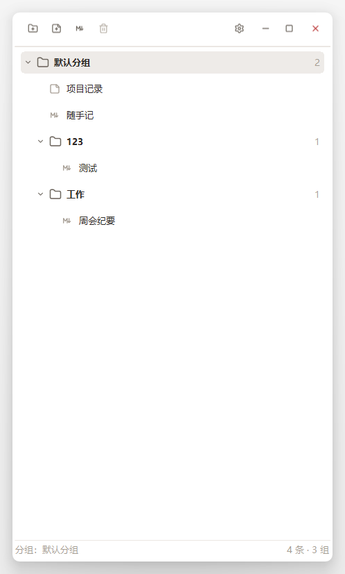
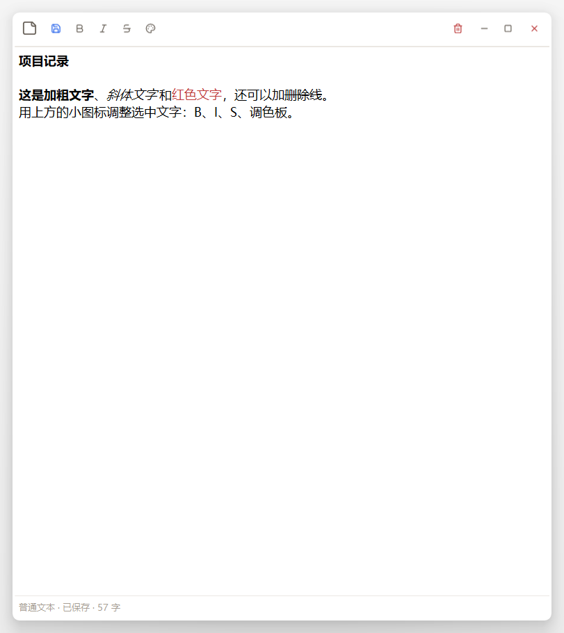
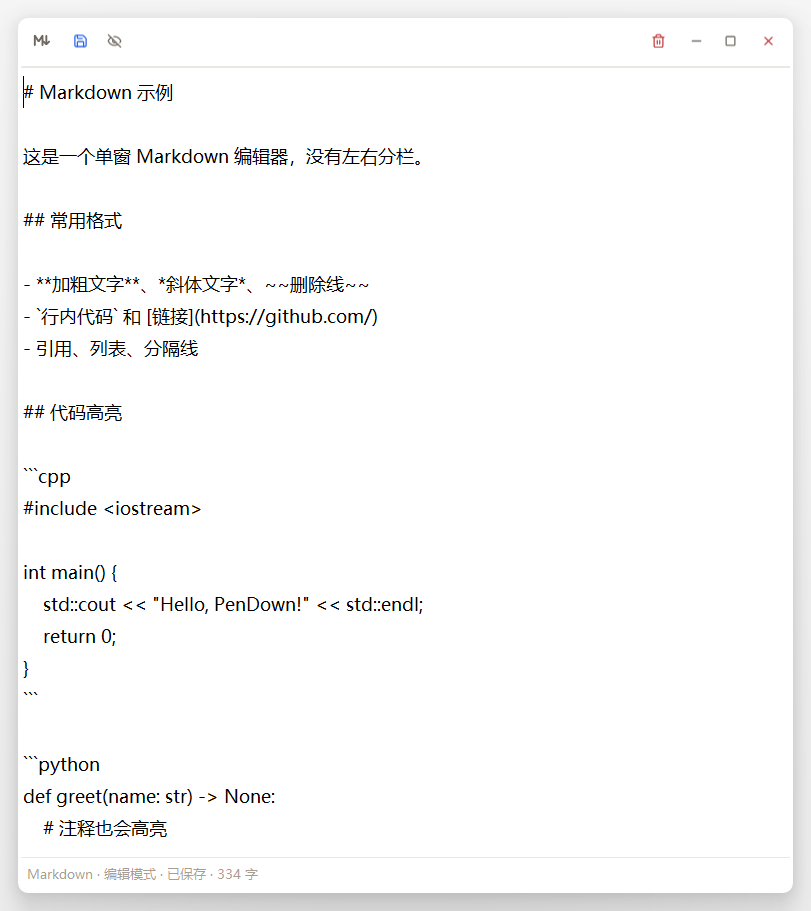
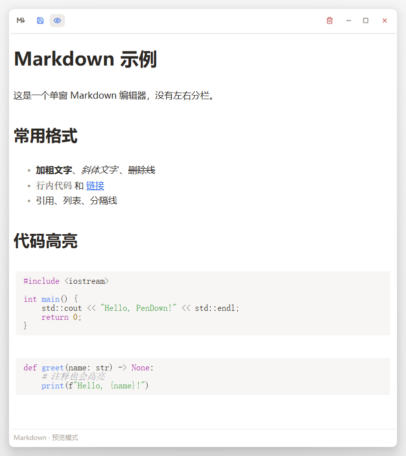

# PenDown · 轻量 Windows 便签


PenDown 是一个便携的 Windows 桌面便签工具，只做便签这一件事。支持普通富文本和 Markdown 两种格式，数据直接以文件夹和文件保存，不依赖数据库。

- **便携**：整个文件夹拷走就能用，不需要安装器
- **双格式**：普通富文本便签（`.wxr`）+ Markdown 便签（`.md`）
- **轻量**：无数据库，默认离线可用；Git 同步是可选功能
- **桌面友好**：系统托盘 + 全局快捷键 + 单实例运行

## 截图

| 主界面 | 普通文本便签 |
| :---: | :---: |
|  |  |
| **Markdown 编辑** | **Markdown 预览** |
|  |  |

## 功能

- 主窗口
  - 窄而高的便签布局，顶部图标工具栏，下方多级分组树
  - 分组可以无限嵌套；便签是叶子节点
  - 右键菜单支持新建子分组、新建便签、重命名、移动到分组、删除
  - 主窗口和便签窗口都可以拖动四周边缘或四角调整大小
  - `Del` 删除，`F2` 重命名 / 打开便签，`F5` 刷新
  - `Ctrl+N` 新建普通便签，`Ctrl+M` 新建 Markdown 便签，`Ctrl+Shift+N` 新建分组
- 便签编辑
  - 便签打开为独立窗口，可以脱离主窗口自由拖动
  - 正文第一行自动作为便签标题和文件名
  - 关闭未保存内容、删除便签都会二次确认
  - `Ctrl+S` 保存
- 普通文本便签
  - 所见即所得编辑器
  - 支持加粗、斜体、删除线、文字颜色
  - 保存为 `.wxr`（wxRichText XML）
- Markdown 便签
  - 单窗编辑，不做左右分栏
  - 眼睛图标或 `Ctrl+P` 切换预览
  - 预览支持标题、列表、引用、链接、行内代码和代码块
  - 代码块按语言高亮关键字、字符串、注释和数字，支持 C/C++、Python、JavaScript/TypeScript、JSON、Shell、SQL、HTML/CSS 等常见语言
  - 保存为 UTF-8 `.md`
- Git 同步（可选）
  - 设置里配置仓库地址、分支、用户名和密码/访问令牌
  - 可以指定本地 `git.exe` 的实际路径；留空时自动检测
  - 数据目录直接作为 Git 仓库；`.git` 不会出现在便签列表里
  - 整个 `data` 目录一起同步：分组、普通便签（`.wxr`）、Markdown 便签（`.md`）和其他文件
  - 空分组通过隐藏的 `.pendown-group` 标记保留
  - 推送：提交本地改动后强制推送，本地覆盖远程
  - 拉取：先自动备份，再用远程内容强制覆盖本地
  - 不处理合并冲突
- 系统托盘与全局快捷键
  - 关闭主窗口时隐藏到托盘，托盘右键“关闭”才真正退出
  - 左键单击 / 双击托盘图标恢复主窗口和便签窗口
  - 隐藏到托盘后自动回收工作集，降低任务管理器内存占用
  - 全局快捷键在托盘状态下仍然有效
- 单实例运行
  - 重复启动不会打开第二个进程，而是恢复已有主窗口

## 下载与运行

从 [Releases](../../releases/latest) 下载最新的 `PenDown-*-win64.zip`，解压后双击 `PenDown.exe`。

- 系统要求：**Windows 10 / 11 x64**
- 不需要安装 Visual Studio、CMake、vcpkg、.NET、Python 或其他开发工具
- VC++ 运行库已随压缩包附带
- 首次启动会在 exe 同级自动创建 `data` 文件夹
- 程序没有代码签名，Windows SmartScreen 可能提示“已保护你的电脑”，选择“更多信息 → 仍要运行”

## 使用方式

### 主窗口

顶部工具栏从左到右：

1. 新建分组
2. 新建普通便签
3. 新建 Markdown 便签
4. 删除选中项
5. 设置

在分组上右键可以继续新建子分组。没有选中分组时新建便签，会自动放入“默认分组”。

拖动窗口四周边缘或四角可以调整窗口大小。右键分组或便签选择“移动到分组...”，可以把它们移动到其他上级分组。

### 便签编辑

新建便签后会出现独立编辑窗口：

- 第一行就是标题，保存时用第一行生成文件名
- 右上角可以保存、切换 Markdown 预览、删除、最小化、最大化、关闭
- 关闭有未保存内容的便签时会提示是否保存
- 普通文本便签使用 `.wxr`，Markdown 便签使用 `.md`

Markdown 编辑器右上角的眼睛图标用于切换预览模式；`Ctrl+P` 也可以切换。

### 托盘与快捷键

关闭主窗口不会退出程序，而是隐藏到系统托盘。托盘右键“关闭”才是真正退出。

默认全局快捷键：

| 快捷键 | 作用 |
| --- | --- |
| `Ctrl+Alt+H` | 显示主窗口 |
| `Ctrl+Alt+N` | 新建普通便签 |
| `Ctrl+Alt+M` | 新建 Markdown 便签 |

在设置（齿轮图标）→“快捷键设置”中可以修改。支持 Ctrl / Alt / Shift 的任意组合加字母或数字，也支持 F1–F12 单独使用。新建便签的快捷键只打开编辑窗口，不会把主窗口带出来。

### 数据与备份

默认数据目录是 exe 同级的 `data`：

```text
PenDown/
├─ PenDown.exe
└─ data/
   └─ 默认分组/
      ├─ 购物清单.md
      └─ 工作/
         ├─ 周会纪要.wxr
         └─ 项目 A/
            └─ 接口联调记录.md
```

- 一个目录就是一个分组，可以继续嵌套
- `.md` 是 Markdown 便签，`.wxr` 是普通富文本便签
- 默认分组固定为 `data/默认分组`
- 保存时用正文第一行生成文件名；修改第一行后再次保存会自动改名
- 旧版 `data/tasks.db`、`data/attachments` 不再参与读写；如果旧库里还有需要保留的便签，请自行导出
- 启动参数 `--data <目录>` 可以指定其他数据目录
- 数据目录优先级：`--data` > 设置中的目录 > exe 同级的 `data`
- 设置（齿轮图标）→“数据存储”可以修改数据目录；修改时可选择复制现有便签，旧目录会保留作为备份
- 启用 Git 同步后，数据目录中会出现 `.git` 目录；它不会显示为分组或便签，请不要手动删除
- 分发程序时不要把个人的 `data` 目录一起打包

升级程序时，只替换 `PenDown.exe`、同目录 DLL 和 `icons/`，不要覆盖或删除 `data/`。建议升级前备份整个 `data` 文件夹。

### Git 同步

Git 同步是可选功能，普通使用不需要安装 Git。

1. 安装 [Git for Windows](https://git-scm.com/download/win)。
2. 打开设置 →“Git 同步”，填写：
   - **仓库地址**：HTTPS、SSH 或本地路径都可以，例如 `https://github.com/user/notes.git`
   - **Git 程序**：可填写本地 `git.exe` 的实际路径；留空会自动从 PATH 和常见安装位置查找
   - **用户名 / 密码或令牌**：公开仓库可以留空；使用 HTTPS 私有仓库时填写用户名和访问令牌
   - **分支**：默认 `main`，需要与远程仓库分支一致
3. 关闭所有便签窗口。
4. 点击“推送到远程”或“从远程拉取”。

同步规则：

- 数据目录本身会成为一个 Git 仓库，首次推送或拉取时在 `data/` 中创建 `.git`
- 推送和拉取针对整个 `data` 目录，不是只同步 `.md`：所有分组、普通便签（`.wxr`）、Markdown 便签（`.md`）和其他文件都会一起同步
- 空分组会通过隐藏文件 `.pendown-group` 保留；这个文件不会显示为便签
- 推送先提交本地改动，再执行强制推送；远程和本地不一致时，**以本地为准**
- 拉取会先备份本地便签到 `%LOCALAPPDATA%\PenDown\backups`，再用远程分支强制覆盖本地；本地和远程不一致时，**以远程为准**
- 不做 merge、rebase 或冲突合并；拉取只覆盖配置的分支
- 首次推送可以创建远程分支；拉取要求远程分支已经存在
- 如果远程仓库开启了分支保护，强制推送可能会被拒绝
- 访问令牌使用 Windows DPAPI 加密后保存在本机；远程仓库建议只存放便签文件
- 拉取会保留 `data/.git`，但会删除不在远程分支里的本地便签文件（备份中仍可找回）

## 从源码构建

### 环境

- Windows 10 / 11 x64
- Visual Studio 2022，安装“使用 C++ 的桌面开发”
- CMake 3.21+
- vcpkg

### 构建

```powershell
git clone https://github.com/1148118271/PenDown.git
cd PenDown

# 安装 wxWidgets（只需一次）
vcpkg install wxwidgets:x64-windows

# 指定 vcpkg 路径
$env:VCPKG_ROOT = "C:\path\to\vcpkg"

cmake --preset vcpkg
cmake --build --preset vcpkg-release
```

产物位置：

```text
build/vcpkg/Release/PenDown.exe
```

同目录会自动复制：

- wxWidgets 运行时 DLL
- VC++ 运行库（MSVCP140、VCRUNTIME140 等）

因此整个 `Release` 文件夹可以直接拷到没有开发环境的 Windows 10/11 x64 电脑上运行。

如果系统已经安装 wxWidgets，也可以设置 `WXWIN` 后使用：

```powershell
cmake --preset system
cmake --build --preset system-release
```

### 自检

```powershell
PenDown.exe --selftest selftest.txt
```

自检覆盖默认分组、嵌套分组、Markdown 往返、普通文本文件、第一行标题、重命名和目录级联删除。报告文件为 UTF-8，以 `OK` 或 `FAIL` 开头。

## 技术栈

| 层 | 选型 |
| --- | --- |
| GUI | wxWidgets 3.2（wxVListBox 自绘树、wxRichTextCtrl 普通文本、wxTextCtrl Markdown） |
| 存储 | 文件系统：目录 = 分组，`.md` / `.wxr` = 便签，无数据库 |
| Git 同步 | 系统 `git.exe`；数据目录直接作为工作树；强制推送 / 强制拉取 |
| 语言 | C++17 |
| 构建 | CMake 3.21+ / Visual Studio 2022 x64 |
| 字体 | Windows 系统默认界面字体；Markdown 代码块使用系统等宽字体 |
| 图标 | Lucide（ISC，SVG 随程序分发并按状态着色） |
| 平台 | Windows 10 / 11 x64 |

## 项目结构

```text
PenDown/
├─ CMakeLists.txt
├─ CMakePresets.json
├─ LICENSE
├─ src/
│  ├─ app.cpp                  # wxApp、命令行参数、启动流程
│  ├─ single_instance.h        # 单实例窗口查找与唤醒消息
│  ├─ core/                    # 与界面无关的文件存储层
│  │  ├─ note_store.*          # 目录扫描、分组目录、便签文件读写、标题 / 文件名
│  │  ├─ git_sync.*            # Git 仓库初始化、推送、拉取、本地备份
│  │  ├─ text.*                # wxString / std::wstring 转换
│  │  └─ selftest.*            # --selftest 隐藏测试入口
│  └─ ui/                      # 表现层
│     ├─ main_frame.*          # 窄长主窗口：工具栏、分组树、托盘、快捷键
│     ├─ note_tree_ctrl.*      # 自绘多级分组树（整行选中 / 悬浮色）
│     ├─ note_window.*         # 独立便签窗口（普通文本 / Markdown）
│     ├─ markdown_preview.*    # Markdown 预览模式单窗渲染
│     ├─ name_dialog.*         # 新建 / 重命名分组对话框
│     ├─ settings_dialog.*     # 设置对话框：数据目录、Git 同步、快捷键
│     ├─ git_config.*          # Git 配置读写、DPAPI 令牌加密
│     ├─ app_font.*            # 系统字体与字号辅助
│     ├─ icon_library.*        # SVG 图标加载 / 着色缓存
│     ├─ icon_button.*         # 自绘图标按钮
│     ├─ rounded_panel.*       # 浅色容器
│     ├─ window_effects.*      # 无边框窗口、DWM 阴影和圆角
│     ├─ theme.h               # 主题颜色
│     └─ ui_ids.h              # 控件 / 命令 ID
├─ res/                        # 图标、清单、版本信息
│  └─ icons/                   # Lucide SVG + ISC 许可证
└─ docs/                       # README 截图
```

## 常见问题

### 关闭主窗口后程序去哪了？

程序会隐藏到系统托盘。托盘图标右键菜单里有“打开 PenDown”和“关闭”。只有“关闭”才会真正退出。

### 可以同时开多个 PenDown 吗？

不可以。重复启动会唤醒已有实例，不会启动第二个进程。

### 怎么修改分组或便签的上级分组？

在主界面右键点击分组或便签，选择“移动到分组...”，再选择目标分组即可。不能把分组移动到它自己或它的子分组下。

### 怎么修改数据存储位置？

设置（齿轮图标）→“数据存储”→点击数据目录右侧的文件夹图标选择新目录，然后保存。可以在提示中选择把现有便签复制到新目录，旧目录会保留作为备份；配置会在下次启动时继续生效。

### Git 同步提示找不到 git.exe

安装 [Git for Windows](https://git-scm.com/download/win)，或者在设置 →“Git 同步”→“Git 程序”中填写 `git.exe` 的实际路径，例如 `D:\Git\bin\git.exe`。

### 推送或拉取时冲突怎么处理？

不做冲突合并。推送使用强制推送，以本地为准；拉取会先备份本地数据，再用远程分支强制覆盖本地，以远程为准。详细规则见上面的“Git 同步”。

### 更新程序会覆盖便签吗？

只替换程序文件不会。请不要覆盖或删除 `data` 文件夹；升级前建议备份。

### 为什么没有安装包？

PenDown 是便携程序，解压即用。如果想放到 `Program Files`，需要注意普通用户可能没有写入权限，建议放在用户目录或使用 `--data` 指定单独的数据目录。

### 支持 Windows 7 / 8 吗？

当前发布目标为 Windows 10 / 11 x64，没有在更旧系统上测试。

## 第三方组件

- [wxWidgets](https://www.wxwidgets.org/)：wxWindows Library Licence（LGPL 2.1 + exception）
- [Lucide](https://lucide.dev/)：ISC
- 字体：使用 Windows 系统字体，不随程序分发

## 许可证

本项目采用 [MIT License](LICENSE)。第三方组件遵循各自许可证：

- wxWidgets：wxWindows Library Licence（LGPL 2.1 + exception）
- Lucide：ISC
